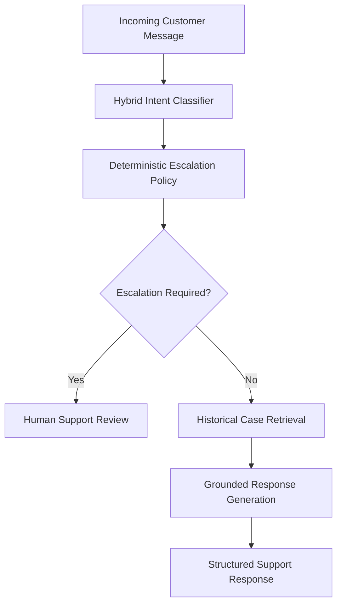

# 🍎 AppleSupport AI Support Agent

An AI-powered customer support agent that analyzes customer messages, identifies intent, retrieves relevant historical support interactions, and generates evidence-grounded responses. The system uses deterministic escalation policies to route sensitive or case-specific requests to a human rather than relying entirely on an LLM.

Built as part of the **Hiver SDE Take-Home Assignment**.

## ✨ Key Features

- **Hybrid Intent Classification** — Classifies incoming customer messages into predefined support intents.
- **Historical Case Retrieval** — Retrieves relevant examples from resolved AppleSupport interactions.
- **Grounded Response Generation** — Uses historical support responses as evidence when drafting replies.
- **Deterministic Escalation** — Applies explicit rules to identify cases that require human intervention.
- **Evaluation Pipeline** — Evaluates retrieval quality, intent classification, and overall agent behavior.
- **Offline Testing** — Supports testing core pipeline behavior without requiring an LLM API call.
- **Failure Analysis** — Documents limitations, failure cases, and opportunities for improvement.
- **Frozen Evaluation Set** — Keeps the golden evaluation set separate from training and retrieval data to reduce evaluation leakage.

## 🏗️ Architecture



The pipeline combines classification, retrieval, and response generation with explicit safety rules. Requests that depend on account access or case-specific actions can be escalated instead of receiving unsupported automated answers.

## 🛠️ Tech Stack

- **Language:** Python
- **AI/LLM:** Groq API
- **NLP:** Hybrid intent classification
- **Retrieval:** Historical support interaction retrieval
- **Evaluation:** Retrieval evaluation, classifier evaluation, and full-agent evaluation
- **Testing:** Offline pipeline and test scripts
- **Version Control:** Git and GitHub

## 📊 Dataset and Evaluation

The project works with historical customer-support conversations from the AppleSupport dataset.

| Dataset component | Count |
|---|---:|
| Original tweet dataset | Approximately 2.8 million |
| Processed AppleSupport interactions | 106,648 |
| Frozen golden evaluation examples | 200 |
| Support intent categories | 10 |

These figures describe the dataset and evaluation configuration documented in the repository.

## 🚀 Getting Started

### Prerequisites

- Python 3.10 or later
- pip
- Git
- A Groq API key for API-backed agent evaluation

### 1. Clone the repository

```bash
git clone https://github.com/Kundank8789/hiver-sde-takehome.git
cd hiver-sde-takehome
```

### 2. Create a virtual environment

**Windows PowerShell**

```powershell
python -m venv .venv
.\.venv\Scripts\Activate.ps1
```

If PowerShell blocks activation, consult the Python virtual-environment documentation or activate the environment using another supported method.

### 3. Install dependencies

```bash
pip install -r requirements.txt
```

### 4. Configure environment variables

Create a `.env` file in the project root and add your Groq API key:

```env
GROQ_API_KEY=your_groq_api_key_here
```

Replace the placeholder with your own API key. Never commit real API keys or other secrets to GitHub.

## ▶️ Running the Project

Run the following commands from the repository root.

### Build support interactions

```bash
python src/build_support_interactions.py
```

### Create golden evaluation candidates

```bash
python src/create_golden_candidates.py
```

### Build the retrieval index

```bash
python src/build_retrieval_index.py
```

### Evaluate retrieval performance

```bash
python src/evaluate_retrieval.py
```

### Evaluate the hybrid intent classifier

```bash
python src/evaluate_hybrid_classifier.py
```

### Run offline tests

```bash
python src/test_offline_agent.py
python src/test_pipeline.py
```

### Run full-agent evaluation

Configure a valid Groq API key, then execute:

```bash
python src/evaluate_full_agent.py
```

Run data-building scripts before evaluation when the required generated artifacts are not already available.

## 📁 Project Structure

```text
hiver-sde-takehome/
├── data/         # Dataset and evaluation data
├── evaluation/   # Evaluation-related resources
├── reports/
│   ├── final_report.md
│   ├── failure_analysis.md
│   └── model_comparison.md
├── src/
│   ├── build_support_interactions.py
│   ├── create_golden_candidates.py
│   ├── build_retrieval_index.py
│   ├── evaluate_retrieval.py
│   ├── evaluate_hybrid_classifier.py
│   ├── evaluate_full_agent.py
│   ├── test_offline_agent.py
│   └── test_pipeline.py
├── .gitignore
├── requirements.txt
└── README.md
```

## 🛡️ Design Principles

- **Evidence over unsupported generation:** Responses should be grounded in retrieved historical support interactions.
- **Deterministic safety:** Escalation decisions should follow explicit policies for sensitive or case-specific workflows.
- **Evaluation integrity:** The frozen golden evaluation set must not be used as training data.
- **Retrieval isolation:** Golden-set examples must be excluded from the retrieval corpus.
- **Honest evaluation:** LLM-as-a-judge scores are diagnostic signals, not definitive ground truth.
- **Failure transparency:** Document system limitations and analyze failure cases rather than reporting metrics without context.

## 📈 Reports and Results

Detailed analysis is available in the repository:

- [Final Evaluation Report](reports/final_report.md)
- [Failure Analysis](reports/failure_analysis.md)
- [Model Comparison](reports/model_comparison.md)

These reports document the evaluation findings, system limitations, and areas for improvement.

## 🔮 Future Improvements

- Improve classification accuracy for ambiguous and multi-intent messages.
- Introduce stronger semantic retrieval and relevance filtering.
- Calibrate confidence thresholds for safer automated responses.
- Expand human-reviewed evaluation coverage.
- Add adversarial testing and low-evidence test cases.
- Improve monitoring of escalation decisions and response quality.

## 👨‍💻 Author

**Kundan Kumar**

- GitHub: [@Kundank8789](https://github.com/Kundank8789)
- Project: [Hiver SDE Take-Home](https://github.com/Kundank8789/hiver-sde-takehome)

---

*Developed as a software engineering take-home project focused on AI-assisted customer support, evidence-grounded response generation, and reliable evaluation.*
